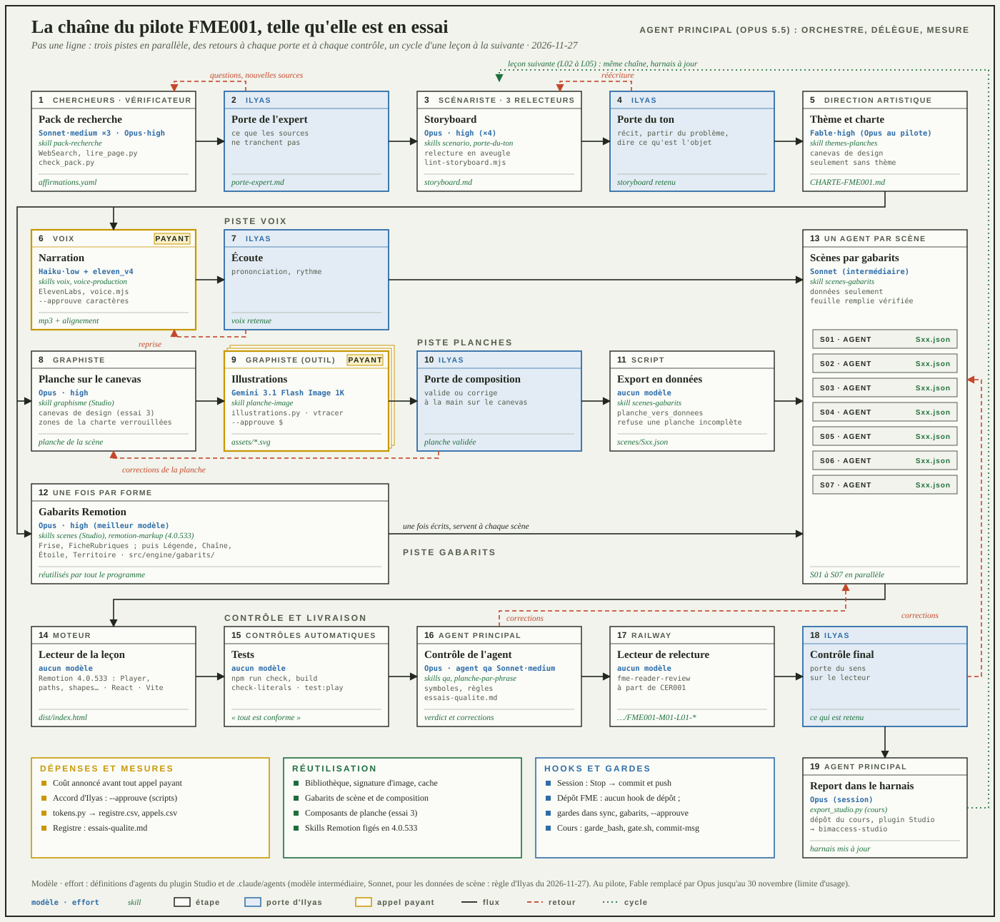

# BIMaccess FME

Le module FME001 de BIMaccess Academy : ce qu'est FME (Feature Manipulation Engine), qui l'a créé et pour quoi, jusqu'à son usage dans le SIG. Et le dépôt pilote où la chaîne de production des leçons apprend à partir **sans source pack**, à mesurer ce qu'elle coûte, et à essayer d'autres modèles.

| Lire | Pour |
|---|---|
| `CLAUDE.md` | les règles du dépôt |
| `docs/feuille-de-route.md` | les critères de réussite, les étapes, les améliorations essayées |
| `docs/journal-methode.md` | ce qui a été constaté et décidé, avec les mesures |
| `modules/M01/plan-module.md` | le plan du module |
| `harnais/skills/pack-recherche/SKILL.md` | construire le pack d'une leçon qui n'en a pas |
| `harnais/banc-modeles/README.md` | comparer les modèles étape par étape |

## La chaîne en essai



Rôles, outils et fichiers de chaque étape, portes d'Ilyas (bleu), appels payants gardés par son accord (or). Le schéma se génère : changer les listes de `docs/_src/schema_chaine.py`, puis `python3 docs/_src/schema_chaine.py`. Bilan des essais : `docs/essais-qualite.md`.

## Commandes

```bash
python3 harnais/skills/pack-recherche/scripts/check_pack.py modules/M01/L01/sources --extraits
```

```bash
python3 harnais/mesures/tokens.py --csv harnais/mesures/registre.csv --etape "FME001-M01-L01 <étape>"
```

```bash
python3 harnais/banc-modeles/appel.py --lister
```

Le harnais de base (plugin Studio, chaîne de production) vient de `BimaccessAcademyinc/bimaccess-studio`, exporté du dépôt `BIMaccess-Learning-Platform`. Ce dépôt n'en garde que ce qui change pendant le pilote.

## Lecteur de relecture (Railway)

| | |
|---|---|
| Projet Railway | `bimaccess-authoring`, environnement `development` |
| Service | `fme-reader-review`, branché sur ce dépôt, branche de travail ; redéployé à chaque push |
| Adresse | https://fme-reader-review-development.up.railway.app |
| Accès | même identifiant et mot de passe que le lecteur de relecture de CER001 (`ACCESS_PASSWORD`, `ACCESS_USER`, repris du service `reader-review` par référence Railway) |
| Construction | `Dockerfile` : `node reader/build.mjs` construit chaque leçon studio (`modules/*/L*/lecon`) et la page d'accueil ; `reader/server.mjs` les sert ; sonde `/api/health` |

Essai local :

```bash
node reader/build.mjs --no-install
```

```bash
ACCESS_PASSWORD=essai node reader/server.mjs
```
